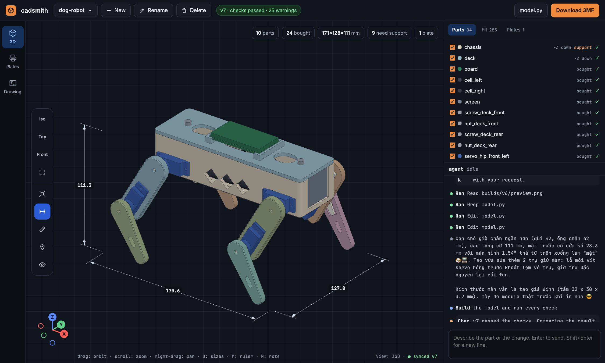
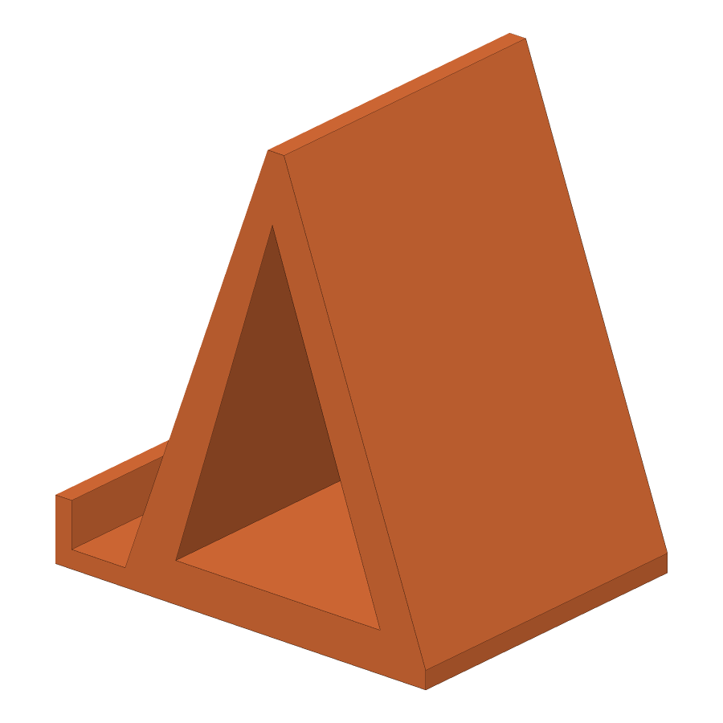
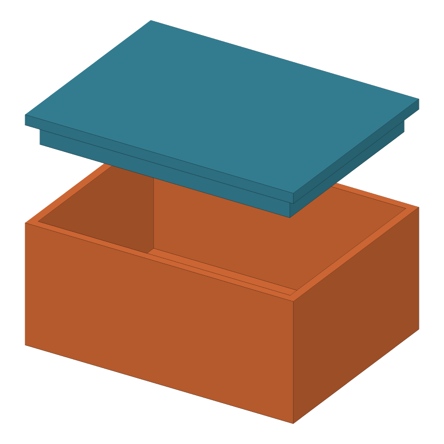
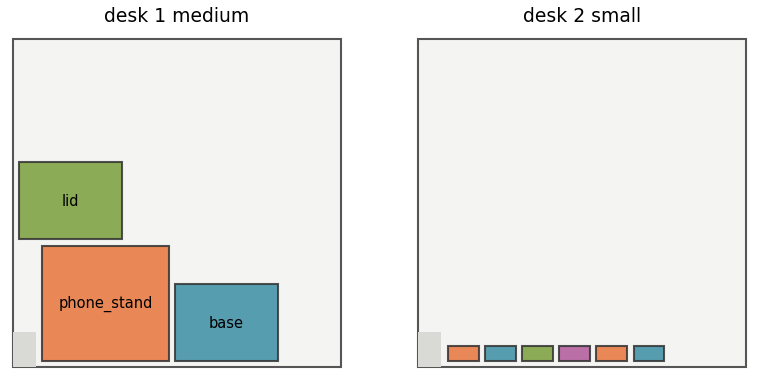
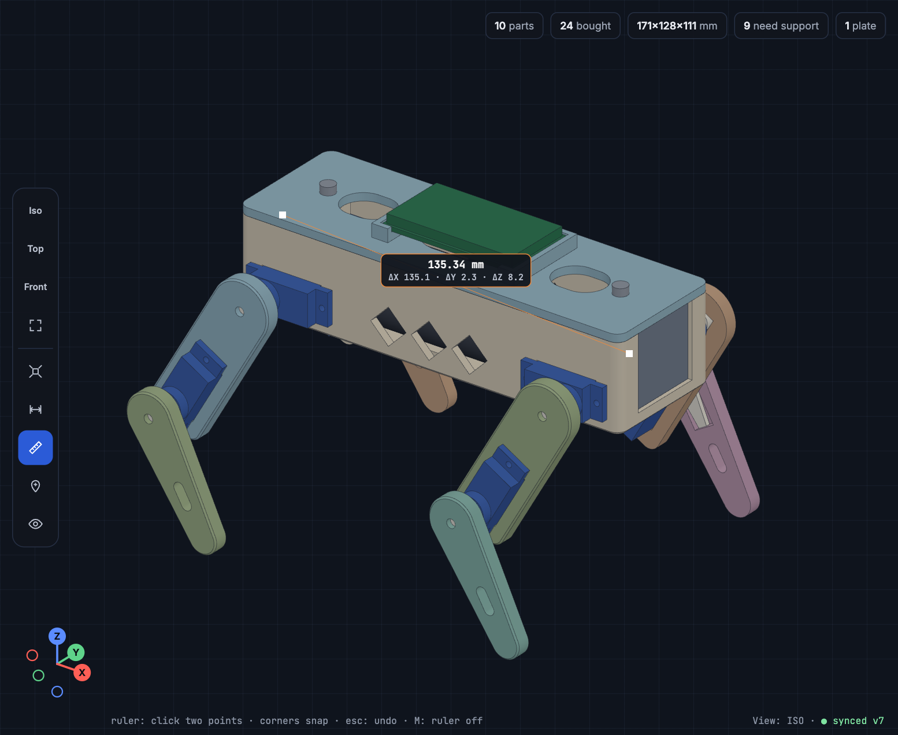
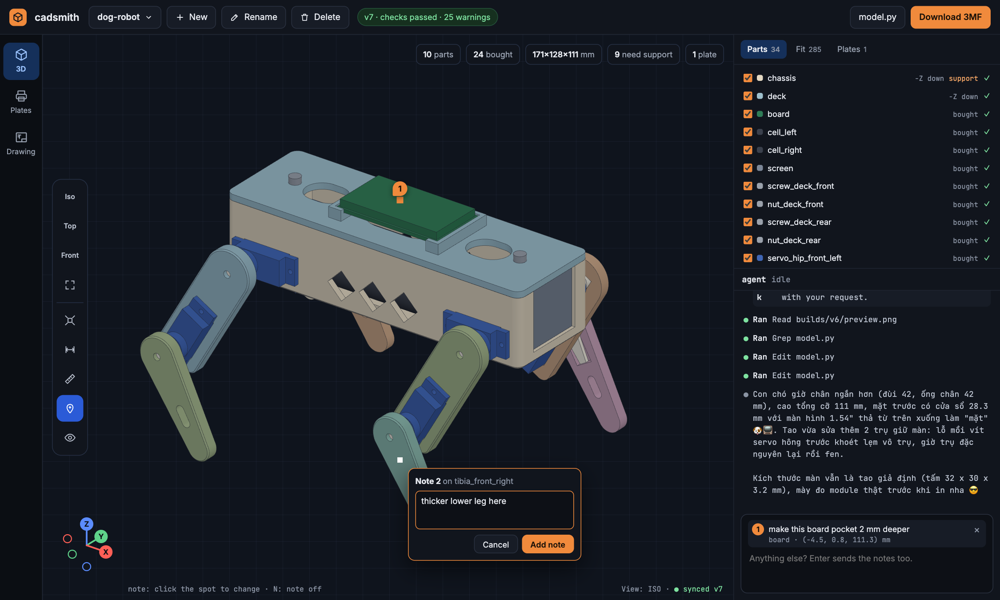
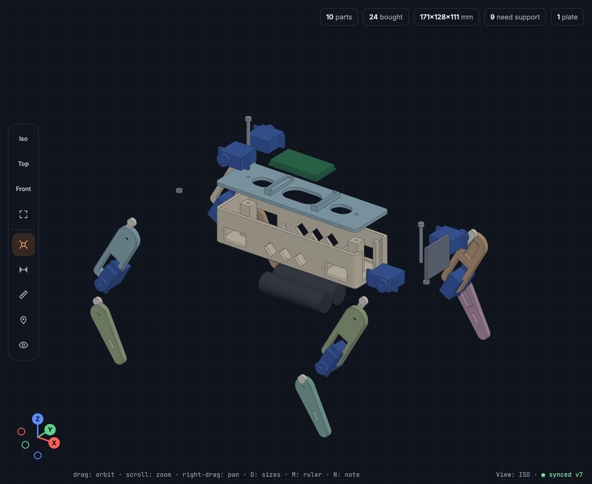
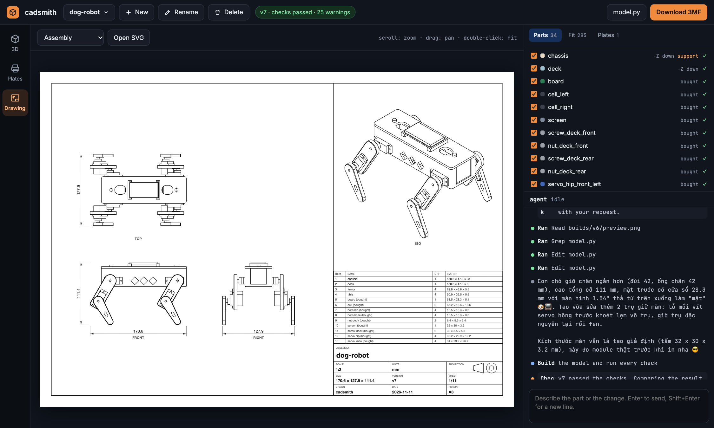
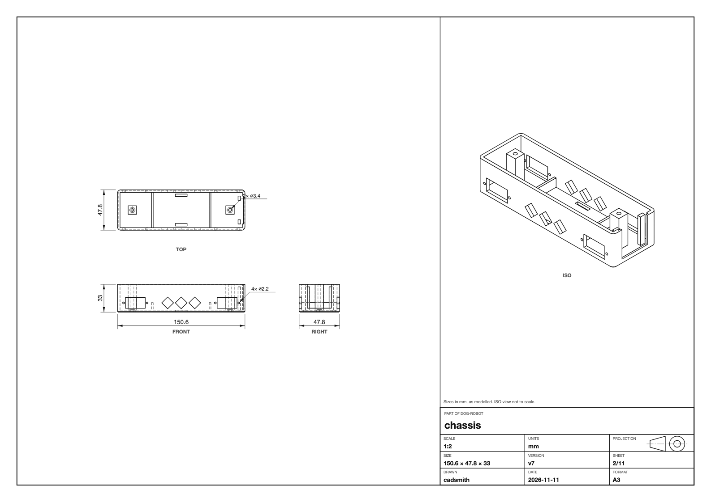

# cadsmith

Parametric CAD parts that are checked before you print them.

You write a part as a short CadQuery `.py` file, by hand or with a coding agent working from a plain
description. cadsmith exports it to STEP, STL and 3MF, measures whether it will print and whether the
parts fit together, and lays everything out on named Bambu Lab plates in one 3MF.



| A single part | Parts that must fit | Named plates in one file |
| --- | --- | --- |
|  |  |  |

## Install

Requires [uv](https://docs.astral.sh/uv/) and Python 3.11 or 3.12.

```sh
uv sync
uv run cadsmith --help
```

On Windows, the easy way: download the ZIP from GitHub (Code, then Download ZIP), unzip it and
double-click `start-windows.bat`. It installs uv and the dependencies, then opens the studio.

Or in PowerShell:

```powershell
powershell -ExecutionPolicy ByPass -c "irm https://astral.sh/uv/install.ps1 | iex"   # installs uv
git clone https://github.com/triluongmh-byte/cadsmith.git
cd cadsmith
uv sync --python 3.12
uv run cadsmith web
```

The studio's agent is [Claude Code](https://claude.com/claude-code): install it and sign in once with
`claude` before you chat.

## Use it

```sh
uv run cadsmith build  examples/lidded_box.py -o out     # STEP, STL and 3MF for each part
uv run cadsmith check  examples/lidded_box.py            # thin walls and overhang
uv run cadsmith fit    examples/lidded_box.py            # clearance between parts
uv run cadsmith plate  examples/*.py -o out/desk.3mf --name desk --printer x1c
uv run cadsmith render examples/lidded_box.py -o out     # PNG preview
```

`check` and `fit` exit with status 1 when a part fails, so they can gate a script. Add `--json` for
machine-readable results. Printers: `x1c`, `p1s`, `p1p`, `a1`, `a1mini`.

## The studio

```sh
uv run cadsmith web        # then open http://127.0.0.1:8420
```

A local web page. The model fills the middle, with its overall sizes drawn on it. Part details and the
chat are on the right. Describe a part or a change in any language, and the model is rewritten, rebuilt
and measured. If a check fails, the agent gets the measurements and tries again, up to three times. It then
looks at a picture of what it built, up to twice, and fixes what does not match your description.

| Measure by hand | Point at what to change |
| --- | --- |
|  |  |
| **Ruler (M).** Click two points on the model. Corners snap, and the label gives the distance with its X, Y and Z parts. Esc removes the last one. | **Note (N).** Click a spot and write what should change there. A numbered pin stays on the part. The notes go out with your next message, each with the part name, the point in millimetres and the way the face points, so the agent edits that spot and leaves the rest alone. |
|  |  |
| **Exploded view.** Parts stacked on the main body lift off in layers, so a lid comes off and what sits inside drops out. Other parts move straight out. | **Drawings.** Every build makes A3 sheets in third-angle projection: the assembly with a parts list, then one sheet per printed part. Scroll to zoom, or open the SVG to print it at scale. |

A part sheet has front, top and right views with hidden lines, overall sizes, centre marks and hole
diameters, and an isometric view:



**Attach files.** Paste a screenshot into the chat, drop files on the page, or use the paper clip. The agent
looks at pictures, so you can mark a problem on a screenshot or show a photo of a part to match. An STL,
such as a figure sculpted in Blender or made by an image-to-3D tool, becomes a solid the agent can size,
put on a base, or cut a peg hole into.

Other controls: **D** shows or hides the overall sizes, the compass in the lower left turns the view to
look along an axis, the eye button shows through parts, and the Plates page shows how parts are laid
out on the print bed.

Each project has its own model, versions and chat. Create, rename and delete them from the top bar.
They live in `cadsmith-workspace/`, and a deleted project moves to `cadsmith-workspace/.trash/`.

The chat uses your signed-in [Claude Code](https://claude.com/claude-code) command line, limited to
reading and editing files in the workspace. The page is served on localhost only and refuses requests
from other sites. Files from a build are served with a sandbox policy, so a model cannot run script in
the page. Set `CADSMITH_GRAYLOG=host:port` to send a log of each POST to Graylog.

## Model files

A model file is ordinary Python, and it runs with your privileges, so only load files you trust.
Build every part in its **assembled** position:

```python
import cadquery as cq
from cadsmith import Fit

def parts():
    return {"base": make_base(), "lid": make_lid()}

FITS = [Fit("base", "lid", min_clearance=0.3, seat="z")]  # optional
ORIENT = {"lid": "+Z"}                                    # optional: this face goes on the bed
QUANTITY = {"lid": 2}                                     # optional: copies to print
BOUGHT = {"servo"}                                        # optional: shown and fit-checked, never printed
```

A single part can define `gen_step()` or a module-level `result` instead of `parts()`. See
[`examples/`](examples/). Helpers for enclosures, screw posts, magnet pockets, snap fits and mating
clearances are in `cadsmith.cadlib`, along with common bought parts: SG90, MG90S and MG996R servos and
their cutouts, boards such as the Pi Pico, Arduino Nano and ESP32 DevKit, 18650 cells, screws and nuts.
Their sizes are nominal, so measure your own parts before a tight fit.

An existing mesh comes in with `import_stl`. It is thinned to 5000 triangles (`detail=` changes that),
sewn into a solid and cached next to the STL, so it can be moved, scaled, unioned and cut:

```python
from cadsmith.cadlib.meshes import import_stl

figure = import_stl("uploads/cat.stl", size=60)   # longest side 60 mm, centred, standing on Z=0
```

## What is checked

**Thin walls.** The whole surface is sampled about every 1 mm and each point measures the distance
through the material to the opposite face. A wall under 0.8 mm fails and one under 1.2 mm warns (change
these with `--min-wall` and `--warn-wall`). Each thin region is reported with its thickness, area and
location.

**Overhang.** Measured with each of the six faces on the bed: overhanging area beyond 45 degrees from
vertical, area touching the bed, and size. The best orientation is picked unless `ORIENT` sets one.

**Fit.** Every pair of parts is measured on the exact B-rep, at 0.3 mm unless a `Fit` states otherwise,
so a collision nobody declared is still caught. A lid that rests on a rim declares `seat="z"`: touching
is then allowed end to end along Z, while side gaps and any overlap are still enforced.

**Plates.** One filament. Largest parts go first, a part joins a plate only if its footprint is at
least a quarter of the largest part there (`--size-ratio`), so big parts print with big parts and small
with small. Each part is turned with its long side along X and rows fill along X. The printer's exclusion
zone is avoided, and each plate is named, such as `desk 1 big`.

## Limits

- The command line starts from a `.py` file; describing a part in words happens in the studio.
- Short bridges count as overhang, so holes in vertical walls report a small overhang area.
- An imported mesh must be closed. One with holes in its surface is refused; repair it first, for example
  with Fix model in Bambu Studio. Drawings of meshes show outlines and creases only, without hidden lines.
- Fits are checked at rest. Motion, snap deflection and press fits (interference) are not modelled.
- Project files are verified by slicing them with the BambuStudio command line. They set the printer
  and default PLA presets; review the settings in BambuStudio before you print.

## Develop

```sh
uv run pytest
```

One test slices a real project and is skipped when BambuStudio is not installed.

## License

MIT. See [LICENSE](LICENSE) and [NOTICE](NOTICE) for what was adapted from earlier MIT projects.
